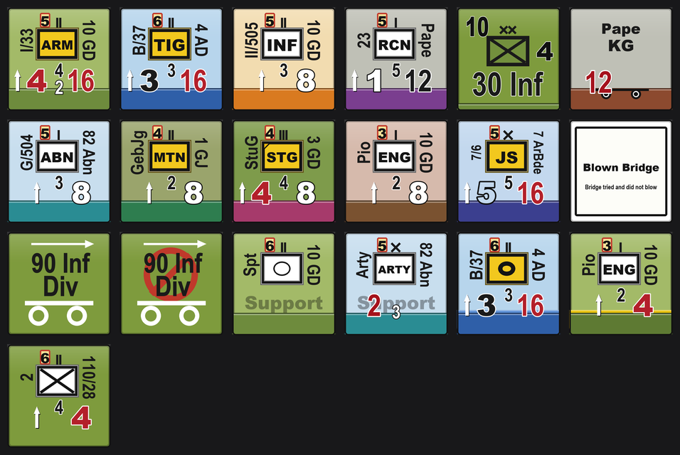
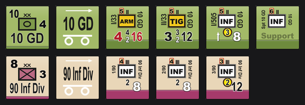
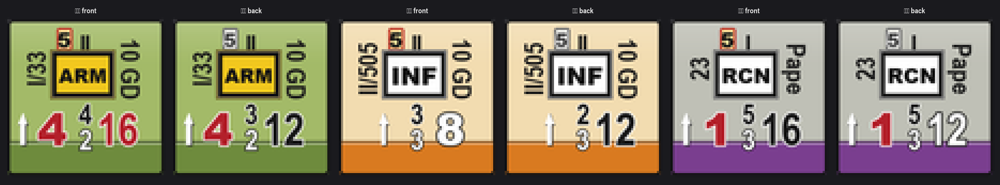
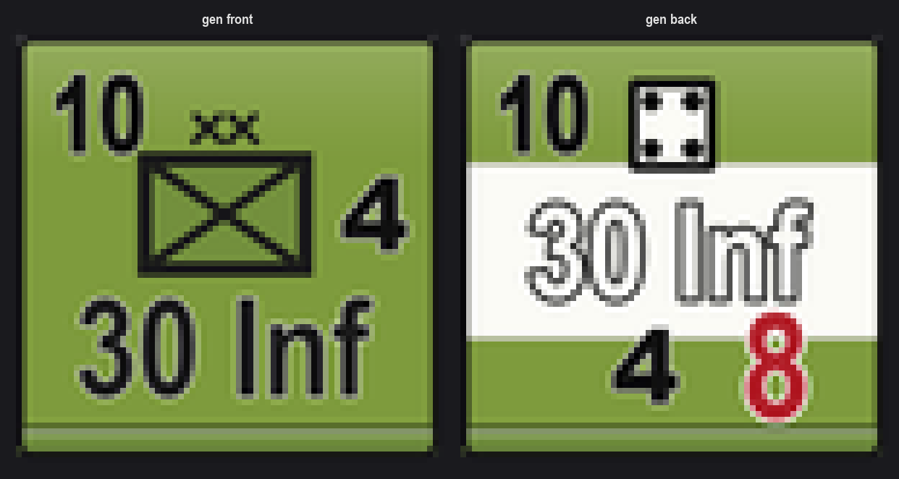
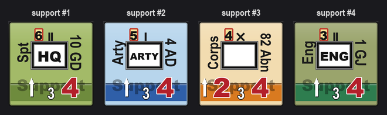
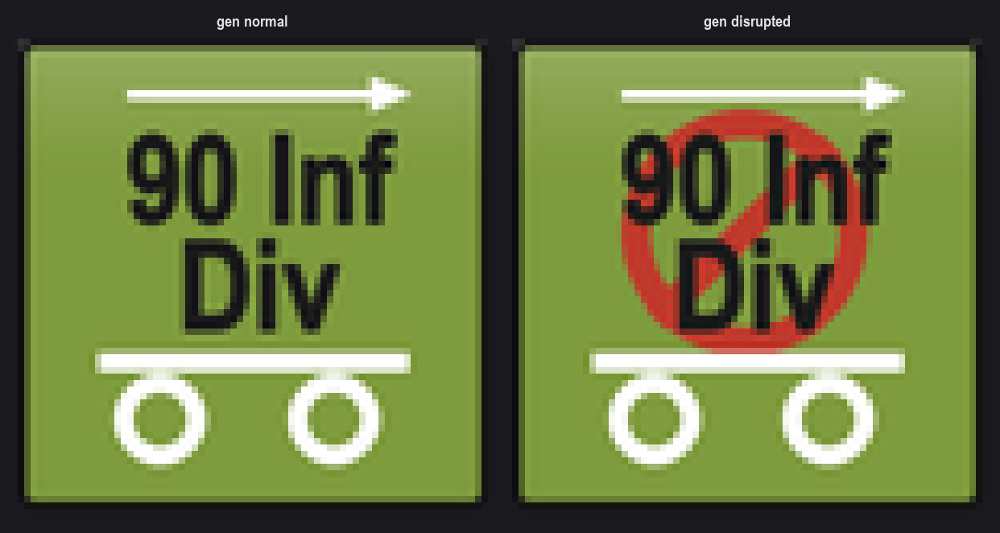
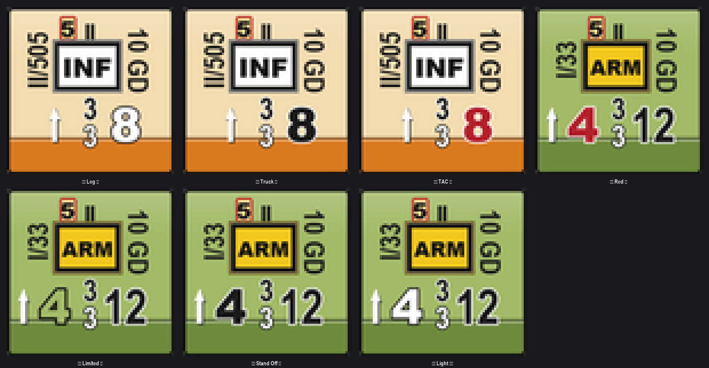
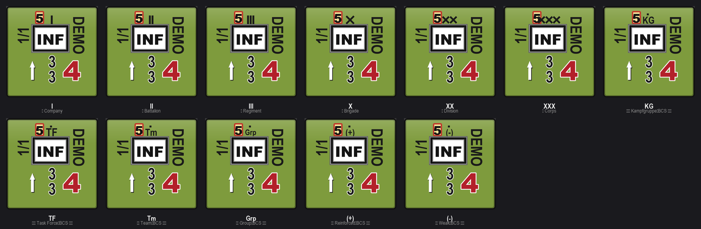

# BCS 算子生成器（CounterGen）

一个给 **Battalion Combat Series（BCS）** 自制算子的桌面小工具：按官方 Unit Key 与真实算子实测版式绘制，
支持战斗单位、指挥部、支援单位、补给车、辎重、标记算子，双面（战斗面/移动面、正常面/已激活面、正常面/失常面），
北约编制规模符号、编制（师）色带、移动力/装甲值分类配色，导出 75×75 PNG 直接放进 Vassal 模块。



> 完整中文使用说明见 **[使用指南.md](使用指南.md)**（11 节：版式规范 / 字段表 / 常量速查 / 自检脚本 / Vassal 部署 / 二次开发）。
> 版式与字段的技术速查见 **[README_技术速查.md](README_技术速查.md)**；二次开发 / debug 请先读 **[开发交接.md](开发交接.md)**。

## 特性

- **纯 Python + Pillow**：无第三方绘图依赖、不联网；几何按 75×75 设计格排版，4× 超采样后 LANCZOS 降采样，75px 原尺寸也不糊。
- **四类双面**：战斗单位（战斗面/移动面）、指挥部 HQ（正常面/已激活面，含六面骰点阵）、支援单位（Support 水印）、补给车（正常面/失常面，含禁止标志）。
- **版式按参照物标定**：`BCSV/Example`、`BCSV/HQ Eg` 里手工框选的坐标直接落成常量。
- **可验证**：9 个 `bcs_verify_*.py` 用像素包围盒量字高/中线/间隙，改版式后一跑就知道有没有破约束。
- **三种入口**：图形界面（tkinter）、命令行、单文件 exe（PyInstaller，约 31MB，无需装 Python）。

## 快速开始

```powershell
pip install pillow
python bcs_gui.py                  # 图形界面；或双击 启动生成器.bat

python bcs_cli.py --spec samples\units.json --out out --size 75 --pair   # 批量出图
python bcs_demo.py                                                       # 生成全部样张
```

## 算子示例

**军队编辑器：一行一枚算子，按编制分组，一键出整套**



**战斗单位：战斗面 / 移动面**



**指挥部 HQ：正常面 / 已激活面**



**支援单位（Support 水印）与补给车（正常 / 失常）**





**移动力 3 类（Leg/Truck/TAC）与装甲值 4 类（Red/Limited/Stand Off/Light）**



**北约编制规模 I / II / III / X / XX / XXX**



## 目录

```
CounterGen/
├─ bcs_render.py     渲染核心（版式常量 L、符号库、双面、导出）
├─ bcs_gui.py        图形界面
├─ bcs_cli.py        命令行 / 批量
├─ bcs_army.py       军队编辑器（表格批量编辑 / 一键出整套）
├─ bcs_app.py        打包入口
├─ bcs_*.py          样张与校验脚本（11 个 verify + 12 个样张脚本）
├─ samples/          样张 PNG + units.json 示例库（全部由本项目渲染）
├─ out/              本机输出目录（对照图 / 批量出图，不入库）
├─ 启动生成器.bat / 启动军队编辑器.bat / 批量导出.bat / 构建EXE.bat
├─ 使用指南.md       完整说明书
├─ README_技术速查.md 版式与字段速查
└─ LICENSE           MIT
```

## 打包成 exe

```powershell
构建EXE.bat
```

## 授权与声明

代码以 **MIT** 发布，详见 [LICENSE](LICENSE)。

本项目仅包含自行编写的绘图代码与依照公开规则书版式复刻的示意图形。

仓库内的样张图（`samples/*.png`）全部由本项目的渲染代码生成，不含任何 MMP / The Gamers
的商业美术资源、Vassal 模块文件或规则书原文。

`Counter/`、`Unit Key.png`、`Example/`、`HQ Eg/` 等游戏素材需自备合法副本，本项目只提供绘制代码与版式实现。
`bcs_compare.py`、`bcs_example_compare.py`、`bcs_hq_sheet.py`、`bcs_norebuild_sheet.py`、`bcs_supply_sheet.py`
可以拿本机素材做逐格对照，但对照图只写到 `out/`（已在 `.gitignore` 内），不随仓库分发；
素材缺省时这些脚本会打印提示并跳过对照。